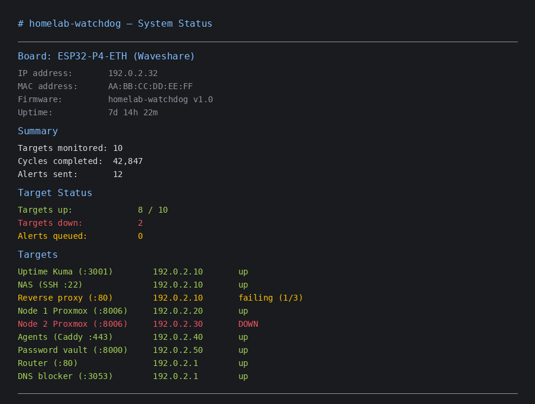
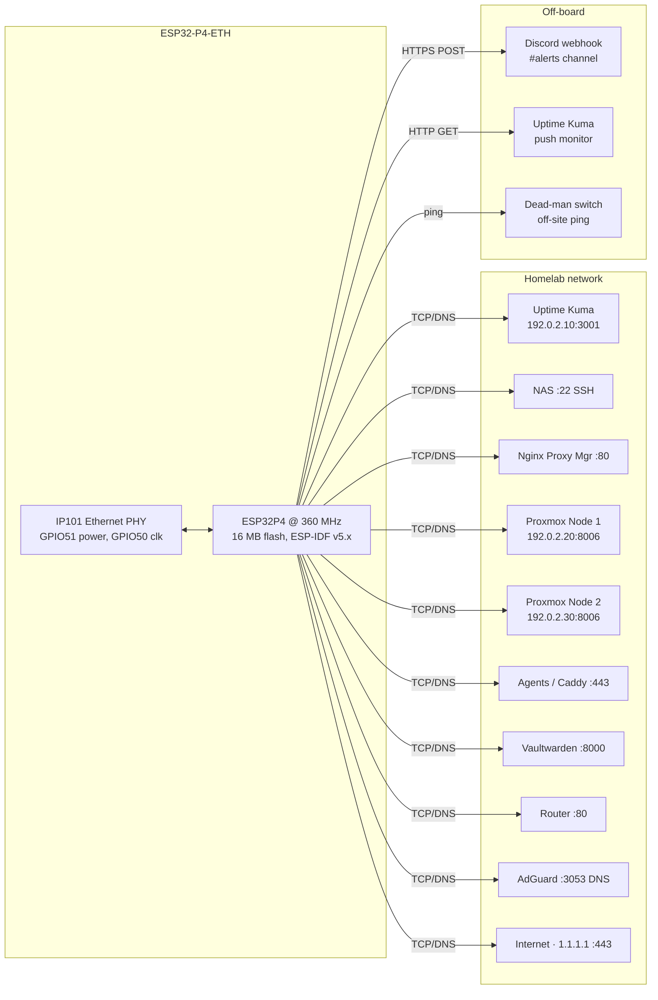

# homelab-watchdog

An independent watcher for a homelab on a Waveshare ESP32-P4-ETH (wired Ethernet / PoE, no WiFi).
It checks ten core services every sixty seconds and alerts Discord directly from the board,
so you get notified even if your servers are down.

## Contents

<!-- toc -->

1. [What it does](#what-it-does)
2. [Screenshot](#screenshot)
3. [Quick start](#quick-start)
4. [Usage](#usage)
5. [Configuration](#configuration)
6. [How it works](#how-it-works)
7. [Status and limits](#status-and-limits)
8. [Roadmap](#roadmap)
9. [Licence and credits](#licence-and-credits)

<!-- tocstop -->

## What it does

- Checks ten core targets every 60 s via TCP connect or DNS query:

  | Target | Address | Check type |
  |---|---|---|
  | Uptime Kuma | 192.0.2.10:3001 | TCP connect |
  | NAS (SSH :22) | 192.0.2.10:22 | TCP connect |
  | Reverse proxy (:80) | 192.0.2.10:80 | TCP connect |
  | Node 1 Proxmox (:8006) | 192.0.2.20:8006 | TCP connect |
  | Node 2 Proxmox (:8006) | 192.0.2.30:8006 | TCP connect |
  | Agents (Caddy :443) | 192.0.2.40:443 | TCP connect |
  | Password vault (:8000) | 192.0.2.50:8000 | TCP connect |
  | Router (:80) | 192.0.2.1:80 | TCP connect |
  | DNS blocker (:3053) | 192.0.2.1:3053 | Raw DNS A-query |
  | Internet (Cloudflare) | 1.1.1.1:443 | TCP connect |

- Three consecutive failures per target triggers a **DOWN** alert to Discord #alerts;
  the next successful check sends a **RECOVERED** notification with approximate downtime.
- Sends each cycle to an Uptime Kuma push monitor (mutual watch: Kuma alerts if the
  watchdog itself dies), and optionally pings an off-site dead-man switch.
- Runs a local web server with live status metrics, individual target states, device
  IP/MAC address, and an OTA-ready restart button.

## Screenshot

<!-- Capture from the watchdog's web UI -->


## Quick start

1. Install ESPHome and flash the firmware over USB.
2. Configure secrets (Discord webhook + optional Kuma / dead-man switch).
3. Plug in Ethernet — the board appears on the network within a minute.

```bash
pip install esphome==2026.9.1   # or: pipx install esphome==2026.9.1
cd homelab-watchdog
esphome run homelab-watchdog.yaml
```

Select the USB serial port when prompted. The first ESP-IDF build downloads several gigabytes of toolchain
and may take some time. After flashing completes, plug in the Ethernet cable — USB power also works.

Within about a minute the board obtains a DHCP lease and posts `🛡️ watchdog online` to the Discord channel.
Verify success by checking that Discord receives an online message listing the number of monitored targets.

After the initial flash, reserve a DHCP entry on your router for the board's MAC address (shown in
the serial logs and on the status page) so it always gets the same IP. Subsequent OTA updates use the
network directly: `esphome run homelab-watchdog.yaml --device <board-ip>`.

## Usage

**View alerts.** Watch the Discord #alerts channel for DOWN and RECOVERED messages from the `homelab-watchdog`
bot. Alerts that arrive while the internet is unreachable are queued (up to twenty) and replayed once
connectivity returns.

**Check live status.** Open the board's web UI at `http://<board-ip>/` (login required, default user `admin`).
The dashboard shows sensor readings for targets-down count, queued alerts, cycles completed, uptime, and
individual status strings for every monitored service.

**Restart the board.** Click "Restart" in the web UI, or re-flash with `esphome run --device <board-ip>`.

## Configuration

Create a `secrets.yaml` file on your own machine (it is gitignored):

```
cp secrets.yaml.example secrets.yaml
```

Fill in the values below. Never commit `secrets.yaml`.

| Key | Required | Description |
|---|---|---|
| `discord_webhook` | Yes | Webhook URL for the Discord alert channel (POST messages here) |
| `kuma_push_url` | Optional | Base push-monitor URL for Uptime Kuma (without query parameters) |
| `deadman_url` | Optional | Off-site dead-man switch ping URL |
| `deadman_token` | Optional | Token parameter for the dead-man switch endpoint |
| `ota_password` | Yes | Long random string used for authenticated ESPHome OTA updates |
| `web_password` | Yes | Password for the board's local web status page (login user is `admin`) |

## How it works

The firmware runs two main components: an ESPHome YAML configuration (`homelab-watchdog.yaml`) that wires up
the board's hardware peripherals, and a custom C++ component (`watchdog.h`) that implements the monitoring logic.

The ethernet link establishes before the watchdog task starts. The watchdog task runs independently in its own
FreeRTOS context, cycling through ten targets every 60 seconds. Each target check uses either a non-blocking
TCP socket with a select() timeout (3 seconds) or a UDP-based raw DNS query to AdGuard Directives
(2 seconds timeout). Failure detection requires three consecutive missed checks per target before firing.

The ESP-IDF framework handles all network I/O. SSL/TLS for the Discord webhook uses ESP-IDF's CA bundle
via `esp_http_client` with certificate chain validation. Alert delivery queues to memory when offline and
flushes on reconnect with a twelve-second inter-message delay to respect Discord rate limits.



### Project structure

```
homelab-watchdog/
├── homelab-watchdog.yaml     # ESPHome config (hardware, sensors, web server)
├── watchdog.h                # Custom C++ monitoring component (task, checks, queue, alerts)
├── secrets.yaml.example      # Template: fill in URLs and passwords, never commit this file
├── .gitignore                # Excludes secrets.yaml and build artifacts
├── LICENSE                   # GNU AGPL v3
└── README.md                 # This file
```

## Status and limits

Verified 2026-10-13 against a live homelab (all ten targets reachable at their configured addresses).
Verified again by running `esphome config homelab-watchdog.yaml` locally — configuration builds without errors.

- Ten distinct targets (nine TCP + one DNS). Failure threshold: three consecutive misses per target.
- Cycle interval: 60 seconds fixed. Inter-target delay: 50 ms between successive checks.
- Alert queue capacity: twenty messages. No persistence across reboots.
- Network requirements: IPv4 wired LAN only (no WiFi). Outbound HTTPS to Discord (port 443),
  outbound HTTP to Kuma push endpoint (typically port 3001), outbound HTTPS to dead-man switch.
- RAM overhead: approximately five megabytes compiled on the ESP32-P4 with 16 MB flash.

**Known limitations:**

- Single-board scope: monitors the local network from one device. No distributed coverage.
- No MQTT transport. Alerts only go to Discord via webhook, unless internet is available for queue flush.
- No TLS client certificate support on the ESP-IDF stack for private endpoints beyond standard CA verification.

**Degraded operating modes:**

- Internet unreachable → alerts queue in RAM, heartbeat to Kuma stops, status page still serves locally.
- Kuma unavailable → watchdog continues monitoring and alerts unaffected.
- Dead-man switch down → watchdog continues monitoring; only the off-site keep-alive is skipped.

## Roadmap

| Item | Notes | Priority |
|---|---|---|
| MQTT transport | Publish status to a local MQTT broker as a fallback when internet is unreachable | Medium |
| Target config in EEPROM | Allow adding/removing targets without re-flashing | Low |
| SMTP email alerts | Add a second alert channel alongside Discord for redundancy | Low |

## Licence and credits

Written by Denzel for THEC1LAB. Licensed under the GNU Affero General Public License v3.0.

Hardware reference: Waveshare ESP32-P4-ETH (Waveshare product page / datasheet).
Framework: ESP-IDF v5.x on the Espressif ESP32-P4 processor.
